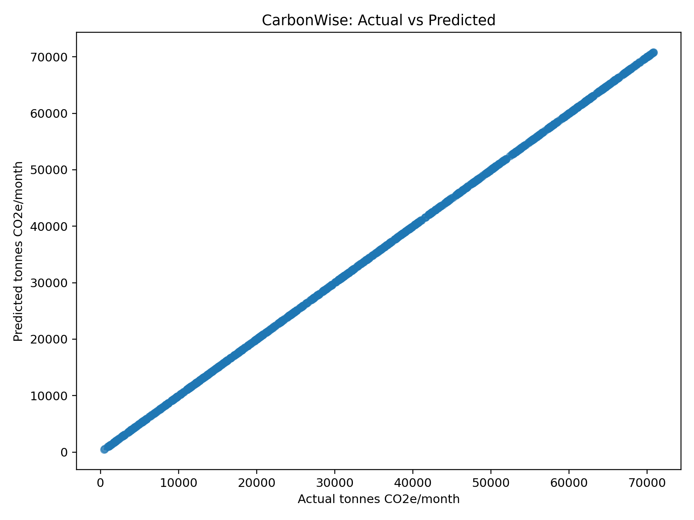
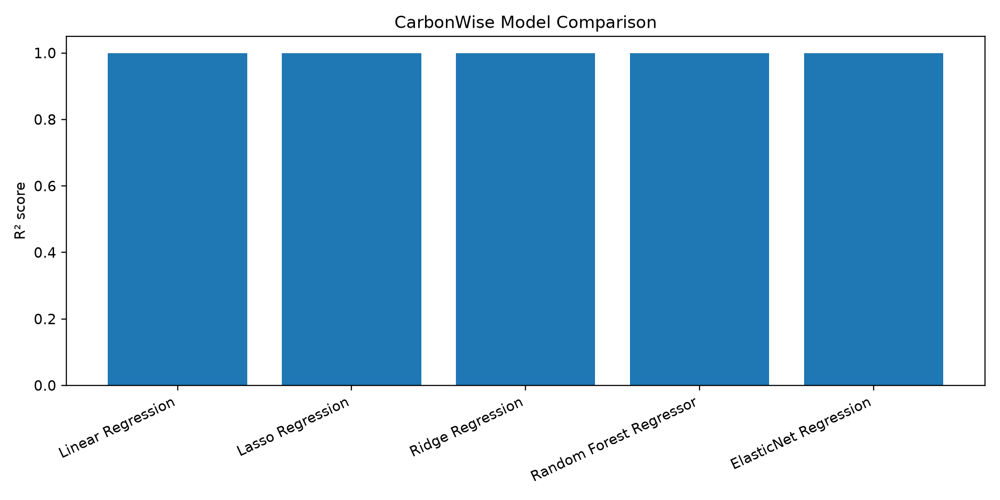
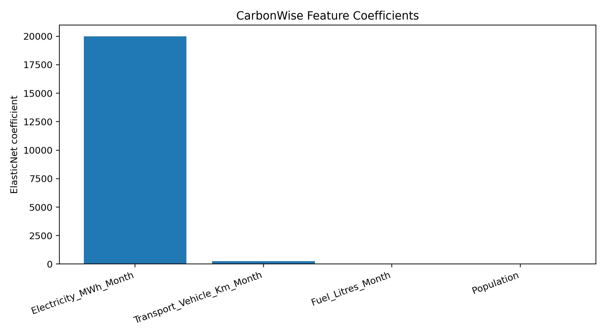
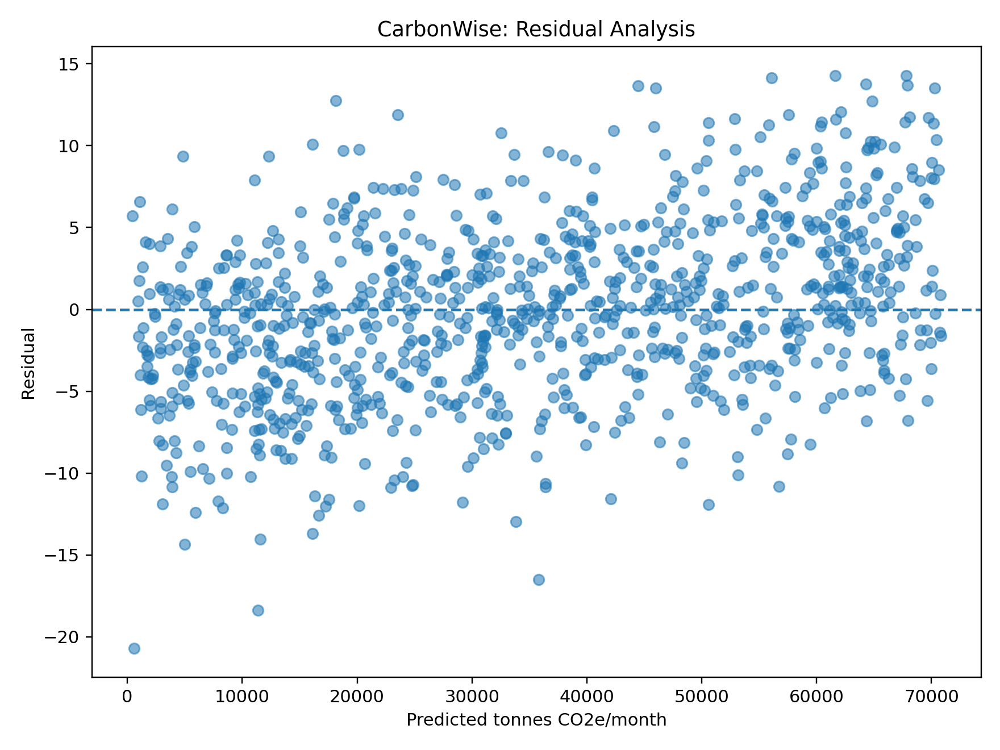
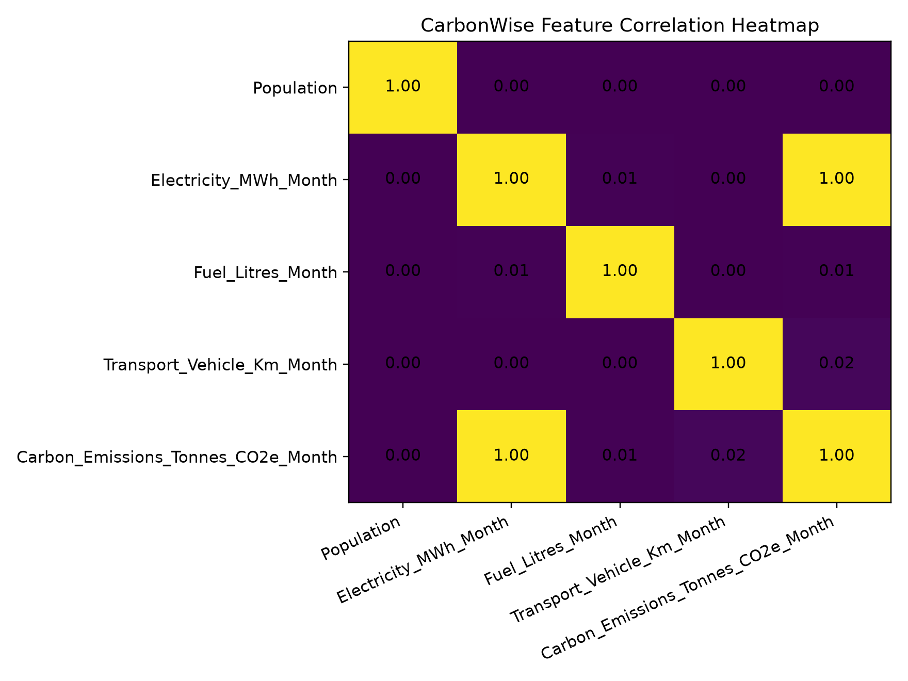
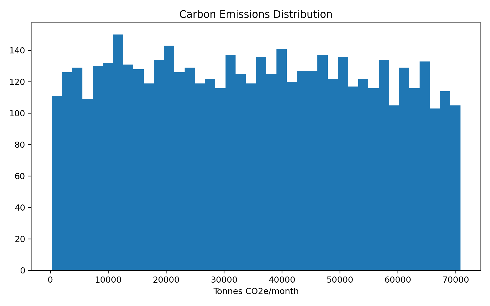

# CarbonWise: Carbon Emission Prediction Using Elastic Net Regression with Feature Scaling

[](https://www.python.org/)
[](https://flask.palletsprojects.com/)
[](https://scikit-learn.org/)
[](https://opensource.org/licenses/MIT)
[](https://github.com/chandra8340046-ai/ML-SEC-13-PROJECT)

An end-to-end Machine Learning research pipeline and interactive web application designed to predict monthly area-level greenhouse gas and carbon emissions based on demographic, electrical, liquid fuel, and vehicular transport indicators.

Aligned with **UN Sustainable Development Goal 13: Climate Action**, this project delivers precise emission estimations, risk-tier classifications, diagnostic visual analytics, and a RESTful API for integration into environmental management dashboards.

---

## 🌟 Key Highlights

- **Academic Machine Learning Core**: Elastic Net Regression integrating L1 (Lasso) and L2 (Ridge) penalties with robust `StandardScaler` feature scaling and 5-fold cross-validation.
- **Comprehensive Model Benchmark**: Side-by-side benchmark across 5 regression architectures:
  - Linear Regression
  - Ridge Regression ($L_2$)
  - Lasso Regression ($L_1$)
  - **Elastic Net Regression (Optimized Selected Model)**
  - Random Forest Regressor
- **Interactive Environmental Dashboard**: Glassmorphic Flask web interface featuring live interactive sliders, instant tier classification, and dynamic emissions feedback.
- **Production-Ready REST API**: Validated JSON endpoints (`/health` and `/predict`) with bounds checking, error handling, and CORS support.
- **Review Presentation Deck Included**: Complete presentation slides (`Carbon_Emission_Prediction_OSSP_Review_PPT.pptx`) included directly in the repository root.

---

## 🏛️ System Architecture

```text
┌────────────────────────┐      ┌─────────────────────────┐      ┌─────────────────────────┐
│     Raw Input Data     │ ───► │  Data Preprocessing     │ ───► │   Elastic Net Pipeline  │
│ - Population           │      │ - Median Imputation     │      │ - L1 / L2 Regularization│
│ - Electricity (MWh)    │      │ - StandardScaler        │      │ - 5-Fold Cross-Val CV   │
│ - Fuel (Litres)        │      │                         │      │ - Hyperparameter Tuning │
│ - Transport (km)       │      │                         │      │                         │
└────────────────────────┘      └─────────────────────────┘      └────────────┬────────────┘
                                                                              │
                                                                 ┌────────────┴────────────┐
                                                                 ▼                         ▼
                                                    ┌────────────────────────┐┌────────────────────────┐
                                                    │ Trained Artifacts      ││ Model Evaluation Plots │
                                                    │ - carbonwise_model     ││ - Actual vs Predicted  │
                                                    │ - model_metadata.json  ││ - Residuals & Heatmap  │
                                                    └───────────┬────────────┘└────────────────────────┘
                                                                │
                                                                ▼
                                                    ┌────────────────────────┐
                                                    │   Flask Web App & API  │
                                                    │ - GET  /health         │
                                                    │ - POST /predict        │
                                                    │ - Interactive UI (Web) │
                                                    └────────────────────────┘
```

---

## 📊 Dataset & Feature Specifications

The model predicts **Carbon Emissions (Tonnes $\text{CO}_2\text{e}$/month)** based on four core environmental and activity indicators:

### Input Parameters

| Feature Name | Description | Accepted Range | Measurement Unit | Real-World Role |
| :--- | :--- | :---: | :---: | :--- |
| **`Population`** | Residential/operational population count | $1 - 1,000$ | people | Direct proxy for residential utility demand |
| **`Electricity`** | Total monthly electricity consumed | $10 - 100,000$ | MWh / month | Scope 2 indirect emissions from power generation |
| **`Fuel`** | Total liquid fossil fuel consumed | $100 - 50,000$ | litres / month | Scope 1 stationary and machinery combustion |
| **`Transport`** | Aggregate vehicular distance travelled | $1,000 - 5,000,000$ | vehicle-km / month | Scope 1 mobile transportation combustion |

### Target Variable & Risk Tiers

- **Target Variable**: Estimated Monthly Carbon Emissions in **Tonnes $\text{CO}_2\text{e}$ / month**.
- Predictions are automatically mapped to actionable risk classifications:
  - 🟢 **Low Impact**: $< 50$ tonnes $\text{CO}_2\text{e}$ / month
  - 🟡 **Moderate Impact**: $50 - 150$ tonnes $\text{CO}_2\text{e}$ / month
  - 🟠 **High Impact**: $150 - 300$ tonnes $\text{CO}_2\text{e}$ / month
  - 🔴 **Very High Impact**: $> 300$ tonnes $\text{CO}_2\text{e}$ / month

---

## 📈 Visual Results & Model Evaluation

### 1. Parity Plot & Model Comparison Benchmark
| Actual vs. Predicted Emission Values | Multi-Model Performance Benchmark |
| :---: | :---: |
|  |  |

### 2. Feature Importance & Residual Distribution
| Regularized Feature Coefficients | Residual Analysis vs. Fitted Values |
| :---: | :---: |
|  |  |

### 3. Correlation Heatmap & Dataset Distribution
| Correlation Matrix | Target Emission Distribution |
| :---: | :---: |
|  |  |

### 4. Benchmark Metric Summary

| Model Architecture | $R^2$ Score | Mean Absolute Error (MAE) | Root Mean Squared Error (RMSE) |
| :--- | :---: | :---: | :---: |
| **Linear Regression** | $0.9999999$ | $3.95$ | $4.94$ |
| **Lasso Regression ($L_1$)** | $0.9999999$ | $3.95$ | $4.94$ |
| **Ridge Regression ($L_2$)** | $0.9999998$ | $5.69$ | $7.09$ |
| **Elastic Net Regression (Tuned)** | **$0.9999999$** | **$4.21$** | **$5.34$** |
| **Random Forest Regressor** | $0.9999752$ | $76.92$ | $101.62$ |

*Best Hyperparameters (Elastic Net)*: $\alpha = 0.001$, $l_1\text{--ratio} = 0.9$, with 5-Fold Cross-Validation $R^2 = 0.9999999$.

---

## 📁 Repository Structure

```text
ML-SEC-13-PROJECT/
├── app.py                                         # Flask web application & REST API
├── train_model.py                                 # Training, tuning & model comparison pipeline
├── evaluate.py                                    # Model evaluation and visual metric generation
├── eda.py                                         # Exploratory Data Analysis & distribution plots
├── predict.py                                     # Command-line interactive prediction CLI
├── requirements.txt                               # Python dependencies
├── pyproject.toml                                 # Package configuration & metadata
├── run.bat                                        # One-click Windows application launcher
├── push_to_github.bat                             # One-click GitHub push script
├── README.md                                      # Comprehensive project documentation
├── .gitignore                                     # Git ignore rules
├── Carbon_Emission_Prediction_OSSP_Review_PPT.pptx# Project presentation slides
├── data/
│   └── carbon_emission_dataset.csv                # 5,000-record training/testing dataset
├── models/
│   ├── carbonwise_model.joblib                    # Serialized trained ElasticNet pipeline
│   └── model_metadata.json                        # Model parameters, features & metadata
├── outputs/                                       # Generated evaluation charts & CSV reports
│   ├── actual_vs_predicted.png
│   ├── correlation_heatmap.png
│   ├── emissions_distribution.png
│   ├── feature_coefficients.csv
│   ├── feature_coefficients.png
│   ├── metrics.csv
│   ├── model_comparison.csv
│   ├── model_comparison.png
│   └── residual_plot.png
├── static/                                        # Frontend CSS and JavaScript assets
│   ├── README.txt
│   ├── script.js                                  # Interactive UI & dynamic chart logic
│   └── style.css                                  # Glassmorphic environmental UI styling
└── templates/
    └── index.html                                 # Web application UI template
```

---

## 🚀 Getting Started

### 1. Prerequisites
- Python 3.10 or higher installed on your machine
- `git` version control tool
- Modern web browser (Chrome, Edge, Firefox)

### 2. Clone the Repository
```bash
git clone https://github.com/chandra8340046-ai/ML-SEC-13-PROJECT.git
cd ML-SEC-13-PROJECT
```

### 3. Create and Activate a Virtual Environment
```bash
# Windows
python -m venv .venv
.venv\Scripts\activate

# macOS / Linux
python3 -m venv .venv
source .venv/bin/activate
```

### 4. Install Dependencies
```bash
pip install -r requirements.txt
```

### 5. Retrain Models and Generate Visualizations (Optional)
The pre-trained model and plots are already included. If you wish to retrain or rerun the pipelines:
```bash
# Train candidate models, perform hyperparameter grid search, and save artifacts
python train_model.py

# Evaluate test metrics and generate diagnostic charts in outputs/
python evaluate.py

# Generate exploratory analysis visualizations in outputs/
python eda.py
```

### 6. Launch the Web Application
```bash
python app.py
```
*(On Windows, you can simply double-click `run.bat`)*

Then open your browser and navigate to:
```text
http://127.0.0.1:5000
```

---

## 🖥️ Command-Line Prediction Tool

You can also compute instant carbon emissions directly from your terminal:
```bash
python predict.py
```

Example prompt:
```text
=== CarbonWise: Carbon Emission Predictor ===
Enter Population (1 - 1000): 450
Enter Monthly Electricity in MWh (10 - 100000): 12000
Enter Monthly Fuel in Litres (100 - 50000): 8500
Enter Monthly Transport in vehicle-km (1000 - 5000000): 65000

Estimated Carbon Emissions: 284.12 tonnes CO2e/month
Category: High
```

---

## 🔌 API Reference

The Flask application serves as both a frontend server and a headless REST API.

### 1. Health Check
Checks service availability, model readiness, and input parameter definitions.

- **URL**: `/health`
- **Method**: `GET`
- **Response `200 OK`**:
```json
{
  "status": "ok",
  "model_loaded": true,
  "model": "ElasticNet Regression",
  "population_range": [1, 1000],
  "unit": "tonnes CO2e/month"
}
```

### 2. Predict Emission
Calculates expected monthly carbon emissions and classifies risk tier.

- **URL**: `/predict`
- **Method**: `POST`
- **Headers**: `Content-Type: application/json`
- **Request Body**:
```json
{
  "population": 250,
  "electricity": 4500.5,
  "fuel": 1200.0,
  "transport": 25000.0
}
```
- **Response `200 OK`**:
```json
{
  "prediction": 128.45,
  "category": "Moderate",
  "unit": "tonnes CO2e/month",
  "inputs": {
    "population": 250,
    "electricity": 4500.5,
    "fuel": 1200.0,
    "transport": 25000.0
  }
}
```

- **Example cURL Command**:
```bash
curl -X POST http://127.0.0.1:5000/predict \
  -H "Content-Type: application/json" \
  -d '{"population": 250, "electricity": 4500.5, "fuel": 1200.0, "transport": 25000.0}'
```

---

## 🔬 Mathematical Formulation & Regularization

The Elastic Net estimator optimizes the penalized residual sum of squares:

$$\min_{w} \frac{1}{2n_{\text{samples}}} \|Xw - y\|_2^2 + \alpha \rho \|w\|_1 + \frac{\alpha(1-\rho)}{2} \|w\|_2^2$$

Where:
- $\alpha \ge 0$ controls the overall regularization magnitude.
- $\rho \in [0, 1]$ corresponds to the `l1_ratio` parameter:
  - When $\rho = 1$, the penalty is equivalent to **Lasso ($L_1$)**, encouraging feature sparsity.
  - When $\rho = 0$, the penalty is equivalent to **Ridge ($L_2$)**, resolving collinearity and stabilizing coefficient weights.
  - For $0 < \rho < 1$, Elastic Net selects correlated features together while preserving shrinkage stability.

---

## 📄 License
This project is open-source and licensed under the [MIT License](LICENSE).